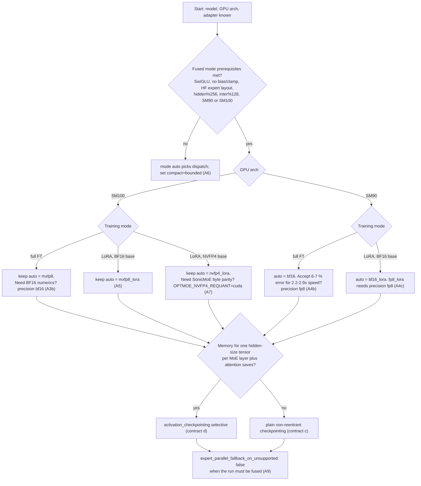
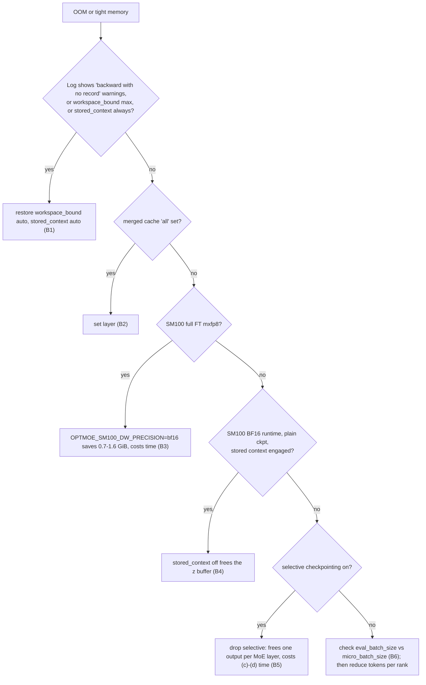
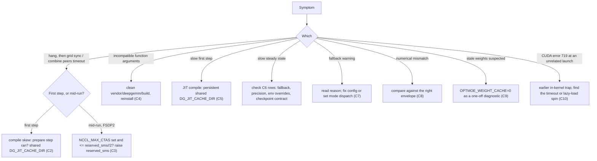

# OPTMoE settings guide for agents

Audience: AI coding agents that choose settings for an OPTMoE training run or debug a slow or
failing one. Rule of thumb: change nothing. Every default below was measured; most toggles exist
to restore an older behaviour for an A/B. Toggle only when a row in section 2 matches an
observation you made.

Authority: names and defaults are read from this repository's
source: `src/optmoe/**`, `vendor/deepgemm/csrc/**`. Axolotl config keys are read from Axolotl
branch `features/optmoe-integrated` @ 68034a3203 (`src/axolotl/integrations/expert_parallel/`).
Numbers come from internal development notes (section 7). Old logs use the names
`ULTRA_SONIC_*`, `MONO_EP_*` and `expert_parallel_mono_ep_*`; they map one-to-one to `OPTMOE_*`
and `expert_parallel_optmoe_*`, but defaults changed since, so check section 6 before trusting an
old number.

Terms used below:

- Shapes (EP8 unless stated, 16,384 tokens per GPU, top-8): 30B = Qwen3-30B-A3B (hidden 2048,
  intermediate 768, 128 experts); 235B = Qwen3-235B-A22B (4096, 1536, 128); Beam (5120, 2560, 256).
- Timing contracts: (c) = literal 2F+B, plain non-reentrant activation checkpointing;
  (d) = F+B with the fused op output saved under selective checkpointing (SAC step);
  B = backward call alone. Numbers from different contracts are never comparable.
- host A / host B = the two 8xB200 hosts the B200 numbers come from. Host A clocks about 7 % lower
  than host B at the same 1000 W cap. Compare numbers only inside one table.

## 1. Default path

What `expert_parallel_optmoe_precision: auto` (package: `precision="auto"`) resolves to, from
`api.resolve_precision`, `api.lora_precision` and the Axolotl plugin's LoRA routing:

| Training mode | SM90 (H100, H200) | SM100 (B200) |
|---|---|---|
| Full fine-tune, BF16/FP32 masters | `bf16` | `mxfp8`: MXFP8 forward, fused MXFP8 backward, MXFP8 dW |
| Expert LoRA on a BF16 base | `bf16_lora` | `mxfp8_lora` (E4M3 pools, Triton adapter grads, merge fused into the forms builder) |
| Expert LoRA on a modelopt packed NVFP4 base | unsupported, falls back | `nvfp4_lora` (frozen NVFP4 experts, `cuda_fused` requant, `layer` merged cache) |

Defaults that apply on every path: workspace bound `auto`, owned-backward ring floor 1 wave (SM90
BF16: 4 waves), weight-layout cache on with the optimizer post-step hook, lazy BF16 pools,
stored context `auto` (acts only on the SM100 BF16 runtime under plain checkpointing),
16 reserved SMs with `NCCL_MAX_CTAS = 8` (`5` under HSDP), prepare step at train begin (Axolotl).
SM90 blockwise FP8 (`fp8`, `fp8_lora`) runs E4M3 transport and combine by default.

Required, not optional (Axolotl): `expert_parallel_backend: optmoe` (`auto` never picks it),
`expert_parallel_size x dp_shard_size == world size` with the EP group inside one NVLink node,
non-reentrant `activation_checkpointing`, `fsdp_config.state_dict_type: FULL_STATE_DICT`.
Fused mode also needs plain SwiGLU experts in HF `gate_up_proj [E, 2I, H]` / `down_proj [E, H, I]`
layout, no biases, no clamp, `hidden % 256 == 0`, `intermediate % 128 == 0` (`% 256` both for
`nvfp4_lora`).

Verify what ran, from the logs, before changing anything:

- `expert_parallel: optmoe runtime, <N> tokens/rank, <E> experts, top-<k>, precision=
`
- `expert_parallel: optmoe kernels prepared on every rank in <s>s`
- `optmoe stored context (auto): ...` (one line with the decision)
- `expert_parallel_backend=optmoe is unsupported here: <reason>. Falling back to expert_parallel_backend=torch` (you are not on OPTMoE at all)
- `optmoe: the MXFP8 persistent backward currently supports hidden sizes that are multiples of 512, so hidden <H> runs the BF16 persistent backward`

Two Axolotl facts that change how you toggle:

1. The plugin writes `OPTMOE_WORKSPACE_BOUND`, `OPTMOE_STORED_CONTEXT`,
   `OPTMOE_NVFP4_MERGED_CACHE` and (fused LoRA only) `OPTMOE_LORA_MERGED_CACHE` into `os.environ`
   from the config keys, overwriting values you exported. Under Axolotl set the config key, not the
   variable. Every other `OPTMOE_*` variable is read straight from the environment of every rank.
2. Axolotl always builds the runtime with `reserved_sms = DEFAULT_RESERVED_SMS = 16`. There is no
   config key. Raising it needs the package API (`OptMoERuntime(reserved_sms=...)`).

## 2. Decision flowcharts

Three small charts: A picks the configuration before a run, B handles memory, C handles symptoms.
Each node ID (A1, B2, ...) matches a row in the decision table that follows; the table is the
normative version.

### A. Configuration

### B. Memory headroom (OOM, or less than about 5 % free)

### C. Symptoms

### Decision table

| ID | Observe | Condition | Action | Evidence |
|---|---|---|---|---|
| A1 | model config, `unsupported_reason` | any fused prerequisite fails | Leave `expert_parallel_optmoe_mode: auto`; it picks `dispatch`. Add A6. | `api.unsupported_reason`; Axolotl `plugin._optmoe_fused_config_reason` |
| A3b | SM100, full FT | MXFP8 error (y 6.6 %, dx 6.8 %, dW 6.6-6.8 % vs FP32) is not acceptable | `expert_parallel_optmoe_precision: bf16` (0.2-0.4 % error). Cost on host B, (d), balanced: 30B 5.84 -> 6.42, 235B 12.61 -> 18.44, Beam 24.25 -> 43.90 ms | development notes |
| A3l | SM100, LoRA, BF16 base | as A3b | `expert_parallel_optmoe_precision: bf16` -> `bf16_lora` | development notes |
| A4b | SM90, full FT | 6-7 % error acceptable | `expert_parallel_optmoe_precision: fp8`. 8xH200, (d), balanced: bf16 30.88 / 81.41 / 165.75 ms vs fp8 10.77 / 35.12 / 75.47 ms (30B / 235B / Beam) | development notes |
| A4c | SM90, LoRA | as A4b | `expert_parallel_optmoe_precision: fp8` -> `fp8_lora`. 8xH200 EP8 (d): 10.20 / 29.64 / 63.58 ms. No same-allocation `bf16_lora` timing exists | development notes |
| A5 | LoRA config | DoRA, `lora_dropout > 0`, adapter not `lora`, `use_sonicmoe` false, missing `experts.gate_up_proj` or `experts.down_proj` in `lora_target_parameters` | Fused LoRA is skipped and the run takes dispatch mode. Fix the config to stay fused | Axolotl `fused_lora.config_reason` |
| A6 | `mode` resolved to `dispatch` | always in dispatch mode | `expert_parallel_optmoe_compact: true` + `expert_parallel_optmoe_bounded: true`. 30B EP8 (c): 8xH100 19.22 -> 18.72 ms, 8xB200 12.50 -> 11.91 ms (compact -> bounded) | FH `docs/compose-design.md` 5.7 |
| A7 | `nvfp4_lora` | must match SonicMoE merge-aware bytes (e2e parity test at its 0.9 cosine bound) | `OPTMOE_NVFP4_REQUANT=cuda`; costs a stored transposed base | FH `docs/configuration.md`; development notes |
| A8 | memory headroom | room for one MoE output per layer (64 / 128 / 160 MiB at 30B / 235B / Beam, 16,384 tok) plus attention saves | `activation_checkpointing: {selective: true}` | development notes |
| A9 | job must be fused | silent fallback to `torch` would waste the run | `expert_parallel_fallback_on_unsupported: false` | Axolotl `args.py`, `plugin._optmoe_fallback` |
| B1 | warnings, env | worst-case pools in use | restore `expert_parallel_optmoe_workspace_bound: auto` | development notes |
| B2 | cache mode | `all` set | `layer` | FH `docs/configuration.md` (`OPTMOE_NVFP4_MERGED_CACHE`) |
| B3 | SM100 `mxfp8` | memory binds | `OPTMOE_SM100_DW_PRECISION=bf16` | development notes |
| B4 | stored context log line says stored | SM100 BF16 runtime, plain checkpointing | `expert_parallel_optmoe_stored_context: off` (buffer 1.02 / 1.72 GB at 235B / Beam) | development notes |
| B5 | selective on | memory binds | drop `selective` | as A8 |
| B6 | config | `eval_batch_size > micro_batch_size` | the runtime is sized for `sequence_len * max(micro_batch_size, eval_batch_size) / context_parallel_size` tokens per rank; lower eval batch. Memory effect not measured | Axolotl integration README |
| C2 | first-step trap | `DeepGEMM grid sync timeout` at step 0 | Axolotl: confirm the "prepared on every rank" log line. Package: call `OptMoERuntime.prepare(...)` before step 0 | development notes |
| C3 | mid-run hang under FSDP2 | NCCL kernels cannot get an SM | `NCCL_MAX_CTAS <= reserved_sms // 2` (`// 3` HSDP) before the process group exists; raise `reserved_sms` (package API) | development notes |
| C4 | `TypeError: incompatible function arguments` from `optmoe_deepgemm._C` | stale extension object | `python -m optmoe.install_kernels --source .` (it builds clean) | README; development notes |
| C5 | step 0 takes minutes | cold JIT cache | `DG_JIT_CACHE_DIR` on a persistent, shared path | README; development notes |
| C6 | slow steady state | see section 5 | see section 5 | section 5 |
| C7 | fallback warning | reason names an adapter/quantization/layout | fix config, or `expert_parallel_optmoe_mode: dispatch` | main `docs/configuration.md` |
| C8 | gradient mismatch | precision envelope, compile, atomics | section 5 | section 5 |
| C9 | stale weights | weights written without optimizer step or version bump | call `optmoe.weight_cache.invalidate_weight_caches()` after the write; confirm with `OPTMOE_WEIGHT_CACHE=0` | FH `docs/architecture.md` (weight layout cache) |
| C10 | 719 at unrelated launch | an earlier kernel trapped | look for the timeout message on any rank; in custom code launch producers once before a spinning consumer | FH `docs/architecture.md`; development notes |

## 3. Toggle reference

Each row: current name, default, values, when to change, measured effect (hardware, shape, routing,
contract), cost or risk, evidence. "Restore only" means the value exists to reproduce an older
default; do not set it for training.

### 3.1 Axolotl config keys

| Key | Default | Values | Change when | Measured effect | Cost / risk | Evidence |
|---|---|---|---|---|---|---|
| `expert_parallel_backend` | `auto` | `auto`, `deep_ep`, `torch`, `optmoe` | always set `optmoe` to use OPTMoE | n/a | `auto` never picks `optmoe` | Axolotl `args.py` |
| `expert_parallel_optmoe_mode` | `auto` | `auto`, `fused`, `dispatch` | force `dispatch` only when fused is excluded and you want to skip the check; force `fused` to fail on any fused exclusion | Beam (c), dispatch (bounded) + SonicMoE vs fused: 8xH200 85.09 vs 88.56, 8xH100 87.57 vs 94.69, 8xB200 45.35 vs 45.72 ms; fused row uncompiled with BF16 params quantized per call | at 30B / 235B fused leads (8xH200 13.41 vs 19.09, 42.19 vs 46.67 ms) | README dispatch table |
| `expert_parallel_optmoe_precision` | `auto` | `auto`, `bf16`, `mxfp8`, `fp8`, `fp8_bwd`, `nvfp4_lora`, `bf16_lora`, `mxfp8_lora`, `fp8_lora` | A3b, A4b, A4c | see A3b, A4b | `fp8_bwd` is rejected ("not implemented yet"); `*_lora` without an adapter falls back | `api.py` |
| `expert_parallel_optmoe_fused_lora` | `true` | `true`, `false` | `false` only to compare against dispatch-mode LoRA | 8xB200 EP8 mxfp8_lora (d) 1.75-2.21x faster than dispatch + SonicMoE LoRA (pre follow-up rows); 8xH200 EP8 fp8_lora (d) 10.20 / 29.64 / 63.58 vs dispatch 18.36 / 49.09 / 95.04 ms | `false` raises peak: 8xB200 dispatch LoRA peak 20.6 / 41.7 / 62.8 GiB vs fused 3.9 / 8.7 / 16.8 | development notes |
| `expert_parallel_optmoe_lora_merged_cache` | `layer` | `layer`, `all` | leave | `all` holds one merged copy per layer: 0.14 / 0.56 / 2.34 GiB per layer at 30B / 235B / Beam EP8; step-time gain in a multi-layer model not measured | memory | development notes |
| `expert_parallel_optmoe_nvfp4_merged_cache` | `layer` | `layer`, `all` | leave; never `all` at Beam | Qwen3-30B-A3B-NVFP4 EP4 4xB200, 3,840 tok/rank, 48 layers, 50 steps: `layer` 12.2 GiB peak 1.03 s/step; `all` 19.7 GiB 0.98 s/step. Beam EP8 geometry: `all` 68.6 GiB/rank vs `layer` 2.2 GiB | `all` OOMs at Beam | FH `docs/configuration.md`; development notes |
| `expert_parallel_optmoe_nvfp4_headroom_log2` | `0` | `0` to `4` | only when an `nvfp4_lora` adapter delta outgrows the frozen base (merged weights saturate, forward drifts from an FP32 merge) | 8xB200 dp_shard 2 x EP 4 validator, lr 2e-2, step 5: y error vs FP32 0.287 at `0`, 0.103 at `1`, 0.102 at `2`; steps 0-1 identical to `0` | merged blocks smaller than `6 * 2**-6 * 2**k` times the per-tensor scale lose resolution; re-encoded block count on a real checkpoint not measured | `nvfp4_lora.requant_headroom_log2`; development notes |
| `expert_parallel_optmoe_workspace_bound` | `auto` | `auto`, `max` | never for training; `max` only to A/B | 8xB200 EP8 resident per rank 18.1 / 35.5 / 41.0 -> 4.9 / 7.9 / 9.0 GB (30B / 235B / Beam), step within about 1 %; one layer F+B +0.1-0.15 ms when the backward follows its own forward | `auto`: adversarial routing grows pools to the worst case once | development notes |
| `expert_parallel_optmoe_stored_context` | `auto` | `auto`, `recompute`, `always`, `off` | B4 (`off`); nothing else | acts only on SM100 BF16 runtime (`bf16`, `bf16_lora`) under plain checkpointing, H x I >= 4096 x 1536. 8xB200 (c) off vs auto: 235B 21.51 / 20.69 bal, 26.38 / 26.33 skew; Beam 51.68 / 45.62 bal, 63.92 / 57.81 skew (11-11). Later (host A, 11-12, BF16 bwd, (c)): 235B 23.07 / 23.23, Beam 53.64 / 52.49 | buffer 0.51 / 1.02 / 1.72 GB; `always` skips the workspace record: peak 46.0 vs 13.0 GiB (235B), 79.0 vs 32.9 GiB (Beam); `recompute` with an MXFP8 backward loses (Beam bal (c) 45.78 vs 41.95) | development notes |
| `expert_parallel_optmoe_compact` | `false` | `true`, `false` | dispatch mode (A6) | 30B EP8 (c): fixed layout 20.82 vs compact 19.25 ms (8xH100, overlap-round allocation) | one D2H count per layer; breaks `fullgraph` compile | development notes |
| `expert_parallel_optmoe_bounded` | `false` | `true`, `false` (needs `compact`) | dispatch mode (A6) | see A6; skewed 8xH100 22.23 -> 21.36, 8xB200 13.51 -> 12.60 ms (c) | bitwise vs compact; overflow re-runs the layer | FH `docs/compose-design.md` 5.7 |
| `expert_parallel_fallback_on_unsupported` | `true` | `true`, `false` | A9 | n/a | `true` hides a fallback to `torch` (8xB200 30B (c) torch a2a + SonicMoE 14.13 vs fused 7.77 ms) | README dispatch table |
| `activation_checkpointing.selective` | unset | `true` or `{save: [...]}` | A8 | host B, `precision mxfp8` + MXFP8 dW, Beam bal: (d) 24.25 vs (c) 28.52 ms; the paired driver under-reports (c) on this path by 1.2-1.8 ms (isolated Beam (c) 32.7-33.3 ms, BF16 dW) | one MoE output per layer kept (64 / 128 / 160 MiB) plus attention saves; stored context never acts | development notes |

### 3.2 Mesh, NCCL, SM reservation

| Setting | Default | Values | Change when | Measured effect | Cost / risk | Evidence |
|---|---|---|---|---|---|---|
| `reserved_sms` (package `OptMoERuntime` arg; fixed 16 in Axolotl) | 16 | 0 to physical - 2 | raise (24, 32) if FSDP2 collectives still stall at 16 | `reserved_sms=0`: dp_shard 2 x EP 2 on 4xB200 hung in the first forward (device NVLink barrier timeout), reproduced on host A 11-11. 16 / 24 / 32 all deadlock-free at 4xB200 (3-layer test model, 2 steps). Cost, EP8 B200 compiled (c): +0.16 ms at 16, +0.30 ms at 24; Beam about 0.1 ms at 16 (forms cached) | 0 only without FSDP2 collectives overlapping the kernels | development notes |
| `NCCL_MAX_CTAS` | exported by the plugin: `16 // 2 = 8`, `16 // 3 = 5` with `dp_replicate_size > 1` | 1 to the limit | outside Axolotl: export `optmoe.nccl_env(reserved_sms, dp_replicate)` before `init_process_group` | `check_nccl_env` raises if unset or too large | larger values can deadlock FSDP collectives | `api.nccl_env`, `api.check_nccl_env` |

### 3.3 SM100 full fine-tune

| Variable | Default | Values | Change when | Measured effect | Cost / risk | Evidence |
|---|---|---|---|---|---|---|
| `OPTMOE_SM100_DW_PRECISION` | `mxfp8` under `precision: mxfp8`; else `bf16` | `bf16`, `mxfp8` | B3, or when dW error matters | host B, (d), 3 single-variant processes each: MXFP8 dW 5.83 / 12.56 / 24.23 vs BF16 dW 5.92 / 13.71 / 27.43 ms balanced; skewed 7.07 / 15.67 / 30.48 vs 7.24 / 17.29 / 34.90 | MXFP8 dW: dW error 0.066-0.068 vs 0.060-0.062, peak +0.9 / +1.6 / +0.7 GiB, 500-step loss gap 0.010-0.011 (rerun noise 0.005-0.012). dW of either precision repeats only to about 1e-5 run to run | development notes |
| `OPTMOE_SM100_BACKWARD_PRECISION` | `mxfp8` under `precision: mxfp8`; else `bf16` | `bf16`, `mxfp8` | do not set `mxfp8` on the BF16 runtime: use `precision: mxfp8` instead | host B Beam bal (d): `precision bf16` + this =`mxfp8` 33.25 vs `precision mxfp8` 27.47 ms (BF16 dW both) | explicit `mxfp8` raises at `hidden % 512 != 0`; unset falls back to BF16 backward with a warning | `persistent_backward.precision`; development notes |
| `OPTMOE_SM100_BF16_POOLS` | `lazy` | `lazy`, `eager` | restore only | host A 8xB200 EP8, eager -> lazy peak: full-FT MXFP8 5.08 / 11.29 / 22.05 -> 3.25 / 7.62 / 16.99 GiB; SAC within 0.3 % | `eager` wastes 1.8-5.1 GiB | development notes |
| `OPTMOE_SM100_MXFP8_WEIGHT_FORMS` | `cuda` | `cuda`, `fused`, `compiled`, `triton` | restore only; all four bitwise identical | one B200, Beam 32 experts, BF16 input: `fused` 1.33 vs `cuda` 0.70 ms per build | falls back to `fused` (logged, `compile_fallbacks`) if the CUDA extension fails to build | FH `docs/configuration.md`; development notes |
| `OPTMOE_SM100_DW_DIRECT` | `1` | `0`, `1` | restore only | 8xB200 backward: 30B 4.19 -> 4.14, 235B 15.39 -> 14.99, Beam 35.50 -> 34.06 ms | `0` is not bitwise to `1` (FP32 accumulation order) | FH `docs/configuration.md` |
| `OPTMOE_SM100_INKERNEL_DW`, `OPTMOE_SM100_INKERNEL_DW_WIDE` | `0`, `0` | `0`, `1` | do not enable | conflicting: 8xB200 rebench (11-10, BF16 bwd) Beam bal B 30.48 -> 28.99 ms with `_WIDE=1`; host B (11-11, non-wide) B +0.4 / +6.3 / +8.0 % at 30B / 235B / Beam bal | BF16 backward only, raises above 32 local experts | FH `docs/benchmarks.md` "SM100 opt-ins"; development notes |

### 3.4 SM90

| Variable | Default | Values | Change when | Measured effect | Cost / risk | Evidence |
|---|---|---|---|---|---|---|
| `OPTMOE_SM90_FP8_TRANSPORT`, `OPTMOE_SM90_FP8_COMBINE` | `1`, follows transport | `0`, `1` | restore only; `COMBINE=1` with `TRANSPORT=0` raises | 2xH100 EP2 30B (d): fused_full 14.18 (on) vs 22.80 ms (off). 8xH200 EP8 fp8_lora (d): 10.20 / 29.64 / 63.58 (on) vs 19.23 / 45.52 / 80.14 ms (off) | none measured: fp8_lora FSDP2 worst adapter-grad rel 0.0684 both ways | development notes |
| `OPTMOE_BACKWARD_RING_WAVES` on SM90 BF16 | unset = 4 waves (bounded) | integer >= 0 | never set on SM90 BF16: any explicit value replaces the 4-wave rule | H200 30B backward at 1 wave +2.7 % bal / +4.3 % skew, 2 waves +1.4 / +3.9 %, 4 waves +0.5 / +2.4 % (vs max) | explicit `1` costs 3-4 % | `persistent_backward._bounded_ring`; development notes |
| `OPTMOE_SM90_FP8_WEIGHT_CACHE` | `1` | `0`, `1`, `forms` | restore only | one Triton launch builds all forms, 176-182 vs 493 us per call (single H100) | `0` rebuilds per call | development notes |
| `OPTMOE_SM90_FP8_FUSED_PREP`, `OPTMOE_SM90_FP8_FUSED_WEIGHT_QUANT` | `1`, `1` | `0`, `1` | restore only | fused prep bitwise, forward 3 -> 1 launches, backward 4 -> 1; fused weight quant removed about 1.1 ms backward + 0.4 ms forward of eager prep | none | development notes |
| `OPTMOE_SM90_FP8_ACTIVATION` | `swiglu_fast` on 512-thread launches, else `swiglu` | `swiglu`, `swiglu_fast`, others for kernel experiments | set `swiglu` only to get the bitwise IEEE reference while debugging numerics | `swiglu_fast` passed FP32-reference validators and a 300-step loss curve (2xH100, 739M Qwen3-MoE, two seeds) | other values change the model function | FH `docs/configuration.md`, `docs/benchmarks.md` "Correctness" |

SM90 BF16 at hidden 5120 compiles (combine split in four chunks) but is slow: 8xH100 Beam (c)
179.50 ms BF16 vs 85.79 ms blockwise FP8, peak 51.7 vs 49.2 GiB (FH `docs/benchmarks.md`). A build
that fails with "Hidden is too large" predates that fix: rebuild.

### 3.5 Fused LoRA (`bf16_lora`, `mxfp8_lora`, `fp8_lora`)

| Variable | Default | Values | Change when | Measured effect | Cost / risk | Evidence |
|---|---|---|---|---|---|---|
| `OPTMOE_LORA_MXFP8_POOLS` | `fp8` | `fp8`, `bf16` | `bf16` when memory is ample and adapter-grad error must stay below the MXFP8 dW envelope, or to use `OPTMOE_LORA_WGRAD=grouped`/`loop` | host A 8xB200 EP8 bal, lazy pools: bf16 pools (d) 0.06 / 0.08 ms faster at 30B / 235B, 0.16 ms slower at Beam; peak +1.84 / +3.67 / +5.07 GiB | `fp8`: dA1/dB1 6.75-6.83e-2 (at the envelope) vs 6.2-6.3e-2 with `bf16` | development notes |
| `OPTMOE_LORA_WGRAD` (older `OPTMOE_NVFP4_LORA_WGRAD`) | `triton` for `bf16_lora`/`mxfp8_lora` on SM100; `grouped` on SM90 and `nvfp4_lora` | `grouped`, `triton`, `loop` | restore only | one B200, EP8 pools: 0.93 / 1.61 / 2.08 (grouped) -> 0.73 / 1.20 / 1.66 ms (triton); 8xB200 (d) mxfp8_lora 5.89 / 12.18 / 22.35 -> 5.65 / 11.49 / 21.66 | `grouped`/`loop` with `mxfp8_lora` + `fp8` pools raises; `triton` on SM90 and `nvfp4_lora` unvalidated | FH `docs/configuration.md`; development notes |
| `OPTMOE_LORA_MXFP8_FORMS` | `fused` | `fused`, `merge` | restore only | rebuild per layer 0.24 / 0.81 / 3.14 -> 0.12 / 0.35 / 1.31 ms; Beam peak 16.8 -> 14.4 GiB | `merge` double-rounds (1.3 % of E4M3 bytes differ) | development notes |
| `OPTMOE_LORA_SM90_WGRAD` | `packed` | `packed`, `project` | restore only | 8xH200 EP8 (d), FP8 env, new vs old (`project` + `OPTMOE_LORA_MERGE=torch`): 10.20 / 29.64 / 63.58 vs 11.40 / 37.22 / 84.44 ms; peak 2.96 / 6.83 / 14.71 vs 3.47 / 8.74 / 22.54 GiB | none | development notes |
| `OPTMOE_LORA_MERGE` | `triton` on SM90, `torch` elsewhere | `triton`, `torch` | restore only; do not set `triton` on SM100 (never timed there) | one H100, EP8 experts, both merges per layer: 0.28 -> 0.20 / 1.02 -> 0.57 / 4.19 -> 2.14 ms | `torch` (baddbmm) differs from the single-rounded merge in 10-18 % of BF16 elements | development notes |

LoRA configs that leave the fused path (dispatch mode instead, or fallback to `torch` if
dispatch is also excluded): adapter other than `lora`, DoRA (`peft_use_dora`), `lora_dropout > 0`,
`use_sonicmoe` false, an expert projection missing from `lora_target_parameters`,
`expert_parallel_optmoe_fused_lora: false`, quantized loading (`load_in_4bit`, `load_in_8bit`,
`gptq`, `model_quantization_config`, except the modelopt NVFP4 checkpoint), a packed NVFP4 base
with any precision other than `nvfp4_lora`, and for `nvfp4_lora` also `nvfp4_merge_aware: true`
(source: Axolotl `fused_lora.config_reason`, `plugin._optmoe_lora_config_reason`, main
`docs/configuration.md`).

### 3.6 NVFP4 LoRA (`nvfp4_lora`, SM100)

| Variable | Default | Values | Change when | Measured effect | Cost / risk | Evidence |
|---|---|---|---|---|---|---|
| `OPTMOE_NVFP4_REQUANT` | `cuda_fused` | `cuda_fused`, `cuda`, `triton` | A7 | per-step rebuild per layer, 8xB200: Beam (8,192 tok) `cuda` 3.23 / Triton 10.24 / `cuda_fused` 2.50 ms; 235B 0.90 / 2.75 / 0.74; 30B 0.35 / 0.87 / 0.31 | `cuda` stores a transposed base (81 MiB per layer at 30B EP4, 0.84 GiB per layer at Beam EP8). `cuda_fused` e2e adapter-grad cosine vs SonicMoE merge-aware 0.909 (bound 0.9) vs 0.941 with `cuda`; dx vs FP32 0.235 vs 0.267 | FH `docs/benchmarks.md` "NVFP4 LoRA"; FH `docs/configuration.md` |
| `OPTMOE_NVFP4_LORA_HEADROOM_LOG2` | `0` | `0` to `4` | as the config key `expert_parallel_optmoe_nvfp4_headroom_log2` | see 3.1 | see 3.1; a value outside the range raises | `nvfp4_lora.requant_headroom_log2` |
| `OPTMOE_NVFP4_BACKWARD_RING_WAVES` | `1` | integer >= 0 | restore only | 8xB200 EP8 Beam: backward 11.35 -> 7.98 ms, 2F+B 16.56 -> 13.57 ms (0 -> 1) | none | development notes |
| `OPTMOE_SM100_NVFP4_BACKWARD_OPTIONS` | `2051` | `3`, `0`, `2051` | restore only | 8xB200, NVFP4-only process, B: 30B -0.7 % / +0.3 %, 235B -5.6 % / -5.8 %, Beam (8,192) -5.4 % / -4.4 % (bal / skew) vs `3` | none | FH `docs/benchmarks.md` |

The NVFP4 path is slower with other runtimes resident in the same process (235B (c) 14.27 vs
17.12 ms, Beam 11.03 vs 13.61): benchmark one runtime per process.

### 3.7 Shared backward and workspace

| Variable | Default | Values | Change when | Measured effect | Cost / risk | Evidence |
|---|---|---|---|---|---|---|
| `OPTMOE_BACKWARD_RING_WAVES` | `1` (SM90 BF16: 4 when unset) | integer >= 0 | restore only | Beam, 8,192 tok, B: 8xB200 BF16 25.70 -> 16.66 ms bal, 34.07 -> 22.43 skew; 8xH100 FP8 70.08 -> 37.58 bal, 97.09 -> 50.48 skew (0 -> 1). Single B200 Beam kernel 2 waves 10.05 vs 1 wave 10.39 ms | `0` starves wide-expert backwards | FH `docs/benchmarks.md` "Backward ring floor"; development notes |
| `OPTMOE_WORKSPACE_BOUND` | `auto` | `auto`, `max` | as the config key (Axolotl overwrites the variable) | see 3.1 | | `workspace_bound.py` |
| `OPTMOE_STORED_CONTEXT` | `auto` | `auto`, `recompute`, `always`, `off`/`0` | as the config key | see 3.1 | | `stored_context.py` |
| `OPTMOE_FORWARD_RING_ROWS`, `OPTMOE_FORWARD_RING_TOKENS` | unset | non-negative integers (`0` = worst-case ring) | sweeps only | forced 2,048-row budget: NVFP4 forward +36 % at 16,384 tok/rank, gate active every launch | before fix 4fdcceaf7a a 1,024-row budget (1,920-token ring) hung the SM100 BF16 and NVFP4 forward | FH `docs/configuration.md`; development notes |
| `OPTMOE_STORED_CONTEXT_ROWS` | unset | integer | tests only (fixed z capacity, forces the overflow fallback) | 30B skewed (c) with a 4,096-row buffer 9.64 vs 9.54 ms off | | development notes |

### 3.8 Weight-layout cache

| Variable | Default | Values | Change when | Measured effect | Cost / risk | Evidence |
|---|---|---|---|---|---|---|
| `OPTMOE_WEIGHT_CACHE` | `1` | `0`, `1`, `legacy` | `0` as a one-off stale-weight diagnostic (C9) | `0` rebuilds layouts per call | slower; not a fix | `weight_cache.py`; FH `docs/architecture.md` |
| `OPTMOE_WEIGHT_CACHE_OPTIMIZER_HOOK` | `1` | `0`, `1` | never `0` under FSDP2 | n/a | `0` removes the post-step invalidation safety net | FH `docs/architecture.md` |
| `OPTMOE_WEIGHT_CACHE_KEY` | `auto` | `auto`, `storage`, `storage_epoch`, `object` | never | n/a | `object` is unsafe under FSDP2; FSDP2 validator's `storage_epoch` key without invalidation goes stale (0.83-0.95 rel) | development notes |
| `OPTMOE_WEIGHT_CACHE_ENTRIES` | `2` | integer >= 1 | never below 2 | each entry about 300 MB at 30B EP8 | | development notes |
| `OPTMOE_WEIGHT_CACHE_COMPILED` | `1` | `0`, `1` | restore only | B200 30B: backward call 4.09 -> 3.6 ms, EP8 2F+B 8.28 -> 7.85 ms (round 2) | | development notes |
| `OPTMOE_WEIGHT_CACHE_FUSED` | `0` | `0`, `1` | never | measured as host-only 16-23 us | | development notes |

### 3.9 Build and JIT

| Setting | Default | Change when | Effect / risk | Evidence |
|---|---|---|---|---|
| `DG_JIT_CACHE_DIR` | `~/.dj` | always point at a persistent, shared path for multi-rank or repeated runs | ranks on one host share it; a miss compiles on every rank (no lock, atomic rename); the key hashes source, included headers, flags and compiler, so it never needs manual clearing for correctness | README; development notes |
| Clean `vendor/deepgemm/build` | n/a | after pulling or editing `vendor/deepgemm`, before reinstall | a reused object after a header-only change surfaces as `incompatible function arguments`; `DG_FORCE_BUILD=1` only skips the prebuilt wheel | README; development notes |
| Prepare step | Axolotl: at train begin, automatic | package users: call `OptMoERuntime.prepare(num_tokens=..., weight_dtype=..., lora_rank=..., lora_dtype=..., nvfp4_backend=...)` collectively before step 0 | 2xB200 EP2 MXFP8, rank 1 delayed 90 s: trap without the guard; pass with the lazy guard (step 0 106.5 s) or explicit prepare (prepare 92.3 s, step 0 0.06 s). A repeat call with the same arguments is skipped unless an `OPTMOE_*` variable changed in between. Variants first selected mid-run (stored-context kernels, a new token-count tile bucket, in-kernel dW) still compile without rendezvous, exposure one compile (about 5-15 s) | development notes |
| `torch.compile` with fused LoRA | layers register themselves at their first forward | package users: call `optmoe.lora.register_layer(experts, cache)` for every layer before the first compiled forward (Axolotl does it at train begin) | 12 registered layers, Inductor `fullgraph`: 0 graph breaks for `bf16_lora`, `mxfp8_lora`, `nvfp4_lora` (B200) and `bf16_lora`, `fp8_lora` (H200), loss within 5e-5 of eager. Unregistered layers cost one graph break each, and `fullgraph=True` raises | `lora.register_layer`; development notes |

## 4. Do not toggle

Restore-only selectors (exist to reproduce a previous default or for kernel A/B):

| Name | Reason |
|---|---|
| `OPTMOE_SM100_BF16_POOLS=eager` | 1.8-5.1 GiB more per rank, no speed gain |
| `OPTMOE_SM100_MXFP8_WEIGHT_FORMS` (any non-`cuda`) | bitwise identical, slower |
| `OPTMOE_SM100_MXFP8_COMPILED_QUANT` | legacy name, read only when `_WEIGHT_FORMS` is unset |
| `OPTMOE_SM100_DW_DIRECT=0` | slower, not bitwise to default |
| `OPTMOE_SM100_REQUANT_CONFIG`, `OPTMOE_SM100_MXFP8_FORMS_CONFIG` | launch configs, bitwise to the old values (`1,4,0`, `4,32,0`), defaults about a third / 18 % faster |
| `OPTMOE_BACKWARD_RING_WAVES=0`, `OPTMOE_NVFP4_BACKWARD_RING_WAVES=0` | starves the backward at wide experts |
| `OPTMOE_SM100_NVFP4_BACKWARD_OPTIONS=3` or `0` | 4-6 % slower NVFP4 backward at 235B / Beam |
| `OPTMOE_NVFP4_REQUANT=triton` | 3-4x slower rebuild than `cuda`, same bytes |
| `OPTMOE_NVFP4_REQUANT_FFMA2=0` | scalar variant, 2-6 % slower (FH `docs/configuration.md`) |
| `OPTMOE_LORA_MXFP8_FORMS=merge`, `OPTMOE_LORA_SM90_WGRAD=project`, `OPTMOE_LORA_MERGE=torch` on SM90 | slower, double rounding |
| `OPTMOE_LORA_WGRAD=grouped`/`loop` on SM100 | slower; raises with `mxfp8_lora` fp8 pools |
| `OPTMOE_SM90_FP8_TRANSPORT=0`, `OPTMOE_SM90_FP8_COMBINE=0` | about 2x slower SM90 FP8 backward |
| `OPTMOE_SM90_FP8_WEIGHT_CACHE=0`, `OPTMOE_SM90_FP8_FUSED_PREP=0`, `OPTMOE_SM90_FP8_FUSED_WEIGHT_QUANT=0` | slower per-call prep |
| `OPTMOE_WEIGHT_CACHE=legacy`, `OPTMOE_WEIGHT_CACHE_COMPILED=0`, `OPTMOE_WEIGHT_CACHE_KEY`, `OPTMOE_WEIGHT_CACHE_OPTIMIZER_HOOK=0`, `OPTMOE_WEIGHT_CACHE_ENTRIES` | slower or unsafe under FSDP2 |
| `expert_parallel_optmoe_workspace_bound: max` | 4-5x resident workspace |

Measured losses (declined experiments; leave off):

| Name | Reason |
|---|---|
| `OPTMOE_SM100_INKERNEL_DW`, `OPTMOE_SM100_INKERNEL_DW_WIDE`, `OPTMOE_SM100_INKERNEL_DW_PER_BLOCK` | non-wide in-kernel dW +0.4 to +8.0 % backward on host B; wide gain only in one 11-10 run |
| `OPTMOE_SM100_BACKWARD_PRECISION=mxfp8` with `precision: bf16` | slower than `precision: mxfp8` at 235B / Beam; also makes stored context lose |
| `expert_parallel_optmoe_stored_context: recompute` or `always` | `recompute` loses with an MXFP8 backward; `always` stores in every forward for no measured gain (it keeps the workspace bound) |
| `OPTMOE_WEIGHT_CACHE_FUSED=1` | no measured gain |
| `OPTMOE_SM90_FP8_OVERLAP_EPILOGUE=1`, `OPTMOE_SM90_FP8_DISPATCH_XDY_PACK=1`, `OPTMOE_SM90_FP8_BACKWARD_MAINLOOP=2` | slower at EP8 in the Hopper rounds (FH `docs/configuration.md`) |
| `OPTMOE_SM90_FP8_COMPACT_FORWARD`, `OPTMOE_SM90_FP8_COMPACT_BACKWARD`, `OPTMOE_SM90_FP8_RELAXED_SPINS`, `OPTMOE_SM90_FP8_DISPATCH_PACK_REGISTERS` | kept for experiments only |
| `expert_parallel_optmoe_precision: fp8_bwd` | not implemented; rejected by `unsupported_reason` |

Kernel tuning selectors (each value compiles a new JIT variant; defaults are the measured ones):
`OPTMOE_SM100_BACKWARD_OPTIONS`, `OPTMOE_SM100_BACKWARD_STAGES`, `OPTMOE_SM100_BACKWARD_BLOCK_K`,
`OPTMOE_SM100_BACKWARD_PULL_BYTES`, `OPTMOE_SM100_FORWARD_OPTIONS`,
`OPTMOE_SM100_FORWARD_PULL_BYTES`, `OPTMOE_SM100_NVFP4_OPTIONS`,
`OPTMOE_SM100_NVFP4_BACKWARD_STAGES`, `OPTMOE_SM100_NVFP4_BACKWARD_PULL_BYTES`,
`OPTMOE_SM90_FP8_FORWARD_STAGES`, `OPTMOE_SM90_FP8_BACKWARD_STAGES`,
`OPTMOE_SM90_FP8_FORWARD_MAINLOOP`, `OPTMOE_SM90_FP8_BACKWARD_MAINLOOP`,
`OPTMOE_SM90_FP8_FORWARD_ROLE_REGISTERS`, `OPTMOE_SM90_FP8_ROLE_REGISTERS`,
`OPTMOE_SM90_FP8_TAIL_SCHEDULE`, `OPTMOE_SM90_FP8_FORWARD_SCATTER_MODE`,
`OPTMOE_SM90_FP8_DISPATCH_PULL_BYTES`, `OPTMOE_SM90_FP8_DISPATCH_SPIN`,
`OPTMOE_SM90_FP8_ACTIVATION_LOOP`, `OPTMOE_SM90_FP8_ACTIVATION_CHUNK`,
`OPTMOE_SM90_FP8_ACTIVATION_ALPHA`, `OPTMOE_SM90_FP8_ACTIVATION_LIMIT`,
`OPTMOE_SM90_FP8_FORWARD_VECTOR_SCATTER`, `OPTMOE_SM90_FP8_FORWARD_VECTOR_SWIGLU`,
`OPTMOE_SM90_FP8_FORWARD_VECTOR_HQUANT`, `OPTMOE_SM90_FP8_FORWARD_SWIZZLE_ACCUM_SMEM`,
`OPTMOE_SM90_FP8_FORWARD_DEFER_COMBINE_FENCE`, `OPTMOE_SM90_FP8_FORWARD_RELAXED_SPINS`,
`OPTMOE_SM90_FP8_XDY_VECTOR_PACK`, `OPTMOE_SM90_FP8_VECTOR_HDZ_PACK`,
`OPTMOE_SM90_FP8_VECTOR_DZ_QUANT`, `OPTMOE_SM90_FP8_DX_COMBINE`.

Diagnostics (never in training; some change behaviour):

| Name | Side effect |
|---|---|
| `OPTMOE_SM100_PHASE_TRACE` | disables stored context |
| `OPTMOE_SM100_FORWARD_PHASE_TRACE` | the forward stops recording receive counts, so backward pools fall back to the worst case |
| `OPTMOE_SM100_DIAG_ABLATE`, `OPTMOE_SM100_FORWARD_DIAG_ABLATE`, `OPTMOE_SM90_FP8_DIAG_ABLATE`, `OPTMOE_SM90_FP8_FORWARD_DIAG_ABLATE` | outputs invalid |
| `OPTMOE_SM100_MXFP8_FORMS_DEBUG` | skips phases; output garbage |
| `OPTMOE_SM90_FP8_PHASE_TRACE`, `OPTMOE_SM90_FP8_FORWARD_PHASE_TRACE`, `OPTMOE_SM90_FP8_DIST_TRACE`, `OPTMOE_SM90_FP8_FORWARD_DIST_TRACE`, `OPTMOE_SM100_NVFP4_PHASE_TRACE`, `OPTMOE_SM90_FP8_TRAP_TIMEOUTS` | trace or trap-only builds |
| `OPTMOE_BACKWARD_SEGMENT_TIMING`, `OPTMOE_MXFP8_FORMS_VERBOSE`, `OPTMOE_NVFP4_REQUANT_VERBOSE`, `DG_PRINT_CONFIGS`, `DG_COMM_KERNEL_DEBUG` | logging only |
| `OPTMOE_STORED_CONTEXT_ROWS` | fixed z capacity for overflow tests |

## 5. Symptom to action

| Symptom | Likely cause | Action |
|---|---|---|
| Step 0 hang, then `DeepGEMM grid sync timeout` (all SMs, `grid_sync_idx=0`), then CUDA 719 | a rank started the fused kernel more than 60 s before a peer finished compiling | Axolotl: check the "prepared on every rank" log; package: call `prepare()`; share `DG_JIT_CACHE_DIR` |
| Mid-run hang under FSDP2, then `DeepGEMM grid sync timeout` or `DeepGEMM combine peers timeout` | NCCL collective cannot get an SM | confirm `NCCL_MAX_CTAS` was exported before `init_process_group` and is `<= reserved_sms // 2` (`// 3` HSDP); lower `NCCL_MAX_CTAS`; package users raise `reserved_sms` to 24 |
| Hang with a small `OPTMOE_FORWARD_RING_ROWS` | ring-gate bug fixed in 4fdcceaf7a | unset the variable; rebuild if the tree predates the fix |
| After a timeout on a host, the next run OOMs or runs slow | orphan workers from `timeout -s KILL torchrun` still spin on the GPU | `pkill` the worker script before the next run |
| `TypeError: incompatible function arguments` from `optmoe_deepgemm._C` | stale extension object | clean `vendor/deepgemm/build`, reinstall |
| "Hidden is too large" (SM90 BF16, hidden 5120) | build predates the combine-chunk fix | clean rebuild; prefer `precision: fp8` on Hopper at that width |
| `ValueError` "MXFP8 persistent backward currently supports hidden sizes that are multiples of 512" | explicit `OPTMOE_SM100_BACKWARD_PRECISION=mxfp8` at `hidden % 512 != 0` | unset it (auto falls back to the BF16 backward) |
| `ValueError` "OPTMOE_LORA_WGRAD=... needs the BF16 pools" | `grouped`/`loop` with `mxfp8_lora` fp8 pools | unset `OPTMOE_LORA_WGRAD`, or `OPTMOE_LORA_MXFP8_POOLS=bf16` |
| `ValueError` "In-kernel dW supports at most 32 local experts" | `OPTMOE_SM100_INKERNEL_DW=1` | unset |
| Fallback warning `expert_parallel_backend=optmoe is unsupported here` | config or model fails a fused/dispatch condition | read the reason; fix the LoRA config (3.5 list), remove quantized loading, or set `mode: dispatch` |
| Step 0 takes minutes | JIT compile of every variant | expected once; persistent `DG_JIT_CACHE_DIR` |
| `ValueError: OPTMOE_... must be 0 or 1` at import or first step | a boolean switch set to `true`, `false`, empty or anything else | set `0` or `1`. Applies to `OPTMOE_WEIGHT_CACHE_OPTIMIZER_HOOK` (read at import), `OPTMOE_WEIGHT_CACHE_FUSED`, `OPTMOE_WEIGHT_CACHE_COMPILED`, `OPTMOE_SM90_FP8_FUSED_WEIGHT_QUANT`, `OPTMOE_NVFP4_REQUANT_FFMA2`; `OPTMOE_STORED_CONTEXT_ROWS` and `OPTMOE_SM100_MXFP8_FORMS_CONFIG` also name themselves when malformed |
| `KeyError` reading `cache.entries[id(layer)]` in custom code | the merged-weight caches are keyed by the layer's `key`, not its object id | read `cache.entries[layer.key]` |
| `nvfp4_lora` forward error vs an FP32 merge jumps after a few steps (0.17 -> 0.29 at step 5 of the FSDP2 validator at lr 2e-2) | the adapter delta outgrew the base; the requant keeps the checkpoint's per-tensor scale and clamps merged weights at the base's largest magnitude | lower the learning rate (5e-3 passes: 0.214), or `expert_parallel_optmoe_nvfp4_headroom_log2: 1` |
| Steady-state slow, SM90 `fp8`/`fp8_lora` | `OPTMOE_SM90_FP8_TRANSPORT=0` or `COMBINE=0` in the env (old harnesses set them) | unset both |
| Steady-state slow, SM90 | default `bf16` | A4b: `precision: fp8` if the error budget allows |
| Steady-state slow, any | plain checkpointing (c) | A8: selective checkpointing |
| Steady-state slow, SM100 BF16 runtime with MXFP8 backward | `precision: bf16` + `OPTMOE_SM100_BACKWARD_PRECISION=mxfp8` | use `precision: mxfp8` |
| Steady-state slow at Beam-class widths | `OPTMOE_BACKWARD_RING_WAVES=0` or SM90 BF16 with any explicit value | unset |
| Slow MXFP8 forms, `compile_fallbacks > 0` | CUDA forms extension failed to build, `fused` used | fix the build (compiler, headers); check the log line |
| Steady-state slow, dispatch mode | fixed layout | A6 |
| Timings differ 7-9 % between allocations of the same build | B200 chips clock differently under the 1000 W cap | compare only within one allocation; one variant per process for sub-ms A/Bs |
| OOM | see flowchart B | B1-B6 |
| Repeated "backward with no record" warnings | forward not recorded (custom autograd path or `OPTMOE_SM100_FORWARD_PHASE_TRACE`) | fix the caller; pools otherwise sit at the worst case |
| MXFP8 run shows 6-7 % rel error vs FP32 | expected envelope (y 6.6 %, dx 6.8 %, dW 6.6-6.8 %) | not a bug; BF16 is 0.2-0.4 % |
| dW differs between two identical runs | SM100 dW repeats only to about 1e-5 relative; dscore uses atomics | compare dW with a tolerance, never bitwise; dx is bitwise |
| Compiled run disagrees with an eager reference by about 10 % in expert grads | bf16 Inductor rounding flips a near-tie top-k choice | compare compiled against a compiled reference (or FP32) |
| FSDP2 validator fails every case at tolerance 0.03 on MXFP8 | 0.03 is calibrated for BF16 | use 0.1 for MXFP8, 0.06 for MXFP8 dW on the BF16 backward |
| NVFP4 LoRA e2e parity cosine near 0.9 | `cuda_fused` transposed forms are closer to FP32, further from SonicMoE merge-aware | A7 if parity matters |
| Loss diverges from dispatch LoRA by about 0.02 on `bf16_lora` | adapter-grad pool order is not deterministic (run-to-run mean 0.018) | compare against a repeat of the same config |
| Stale weights: loss ignores an update, or cached layout differs from a fresh build | weights written without an optimizer step or version bump (checkpoint load into existing params, weight sync) | `optmoe.weight_cache.invalidate_weight_caches()` after the write; LoRA: `MergedWeightCache.invalidate()`; confirm with `OPTMOE_WEIGHT_CACHE=0` |
| CUDA 719 at an unrelated later launch, sanitizer shows only a trap | a spinning kernel timed out earlier; in custom code, a producer kernel loaded lazily while its consumer spun | launch every producer (CUDA, Triton, `torch.cuda._sleep`) once before the first spinning consumer; `CUDA_MODULE_LOADING=EAGER` only confirms, Triton still loads lazily |

## 6. Unverified, stale, or conflicting evidence

Corrections to claims that circulate in older notes:

- SM90 FP8 transport and combine are default on since 226c2ac8d7 (2026-11-12), not opt-in. Older
  notes say opt-in; source `persistent_backward.sm90_fp8_transport`
  defaults both to `1`. The H200 rebench fused LoRA rows (fp8_lora slower than dispatch) ran
  without the env and are superseded.
- A header-only DeepGEMM change needs a clean `vendor/deepgemm/build`; it does not need a fresh
  JIT cache. The README says the JIT key hashes every included header.
- MXFP8 backward and MXFP8 dW are the defaults under `precision: mxfp8`. README main text still says
  both are opt-in, and FH `docs/benchmarks.md` "SM100 opt-ins" says the MXFP8 backward covers
  hidden up to 2048; both are stale (source: `persistent_backward.precision`, `dw.MXFP8_BACKWARD_DW_DEFAULTS`).
- `OPTMOE_NVFP4_REQUANT` defaults to `cuda_fused`. FH `docs/architecture.md` says
  `cuda` is the default; stale.
- README stored-context claim "Beam checkpointed layer 51.7 -> 45.6 ms" comes from the 11-11 gate.
  The 11-12 triage (host A, BF16 backward, (c)) measured 235B 23.07 off vs 23.23 auto and Beam 53.64 vs
  52.49. The shape threshold `MIN_HIDDEN_X_INTERMEDIATE` may need to move; not re-measured paired.
- Stored context with an MXFP8 backward: source docstring cites 21.1 vs 19.2 and 45.9 vs 41.9 ms;
  the triage tables give (c) 21.05 vs 19.17 and 45.79 vs 42.23; an older note says 21.1 -> 19.4 and
  45.8 -> 42.0. Different series of the same experiment; this guide uses the triage tables.
- In-kernel dW: FH `docs/benchmarks.md` (11-10, wide tiles) shows a Beam gain; a later run
  (11-11, non-wide) shows losses at every shape. Wide tiles were not re-measured on 11-11.
- `reserved_sms` for the 4-GPU dp_shard 2 x EP 2 mesh: main `docs/configuration.md` says B200
  "needed 24". Round 2 used 24 without tuning; round 3 swept 16 / 24 / 32 and all passed; the
  11-11 run repeated FSDP2 at 16. Evidence supports 16 being sufficient on that test model.
- `expert_parallel_optmoe_stored_context` exists in the Axolotl schema but is missing from main
  `docs/configuration.md`'s key table.
- Axolotl `args.py` docstring says "`fp8_lora` is not implemented yet"; `fused_lora.PRECISIONS`
  includes it and it was validated on 2xH100, 4xH100 and 8xH200. The docstring is stale.
- README overview still says the fused kernels need full fine-tuning; the `*_lora` precisions exist.
- MXFP8 dW default flip date: one note heads the approval
  "2026-11-11" after 11-12 evidence; the order of events implies 11-12.

Not measured or not confirmed in current source:

- NVFP4 LoRA headroom: the number of blocks re-encoded on a real checkpoint, and step time or
  memory with headroom on. The Axolotl key is on branch `features/optmoe-lora-compile-followups`,
  not on `features/optmoe-integrated`.
- The fixes of 2026-11-13 (strict switches, cache keys, layer registration) ran on 8xB200 and
  8xH200; no strict H100 run.
- `bf16_lora` on SM90 has no EP8 timing; `fp8_lora` vs `bf16_lora` on Hopper is unknown.
- Triton adapter-gradient kernels (`OPTMOE_LORA_WGRAD=triton`) on SM90 and on `nvfp4_lora`;
  `OPTMOE_LORA_MERGE=triton` on SM100.
- Prepare step on SM90 entry points; prepare under EP4/EP8 and inside a real `axolotl train` run.
- `lora_merged_cache: all` step time and memory in a multi-layer model.
- Selective checkpointing with `nvfp4_lora`: whether its autograd path is saved like
  `optmoe::persistent_forward` is not measured.
- Skewed routing for the fused-LoRA follow-ups (forms fusion, Triton grads, fp8 pools default).
- HSDP rule `NCCL_MAX_CTAS <= reserved_sms // 3`: from Prime Intellect's scaling docs, never run
  with OPTMoE.
- "top-k must divide 32 on the fused SM100 backward" (development notes):
  no check with that wording found in `api.unsupported_reason` or the launch asserts.
- `DG_JIT_CACHE_DIR` is read by DeepJIT, which `tools/fetch_build_dependencies.py` fetches at build
  time; its read is not in this tree. Default `~/.dj` is from README / main docs.
- 8xH100 strict EP8 timing of the SM90 LoRA defaults (only 8xH200 and 2xH100).
- Peak-memory columns in the 2026-11-12 B200 rebench notes predate lazy BF16 pools (21348a211b);
  current peaks are lower for MXFP8 runs.
- B200 timings come from three hosts, two of them 7-9 % apart in clock; do not
  mix them.

Removed selectors mentioned in logs (do not set; they are ignored or never existed in main):
`OPTMOE_SM90_FP8_DSCORE_WARP_REDUCE`, `OPTMOE_SM90_FP8_DRAIN_OFFLOAD`,
`OPTMOE_SM90_FP8_DISPATCH_PACK_MODE`, `OPTMOE_SM90_FP8_FORWARD_OVERLAP_EPILOGUE`,
`OPTMOE_SM100_BACKWARD_LEAN_DH`, `OPTMOE_NVFP4_BACKWARD_XBLOCK`, `OPTMOE_SM100_NVFP4_BLOCK_K`,
`OPTMOE_SM100_NVFP4_STAGES`, `OPTMOE_SM100_NVFP4_SAT_COUNT`, `OPTMOE_NVFP4_INPUT_SCALE_MODE`
(old prefixes `ULTRA_SONIC_` / `MONO_EP_`). Harness-only variables in logs
(`OPTMOE_BENCH_RESERVED_SMS`, `OPTMOE_CONTRACT_DEEP_EP`, `OPTMOE_TEST_*`, `OPTMOE_TIMING_GPU`,
`OPTMOE_ROOT`, `OPTMOE_VENDOR_DIR`, `OPTMOE_SOURCE_DIR`) belong to scripts that live only on
`full-history`.

## 7. Evidence index

- Development notes = internal measurement logs from the kernel rounds; not published.
- FH = the development repository (`optmoe-dev`): `docs/configuration.md`,
  `docs/architecture.md`, `docs/benchmarks.md`, `docs/compose-design.md`, `docs/ROADMAP.md`.
- Axolotl = `features/optmoe-integrated` @ 68034a3203:
  `src/axolotl/integrations/expert_parallel/{args.py,plugin.py,fused_lora.py,README.md}`,
  `src/axolotl/utils/schemas/activation_checkpointing.py`.
